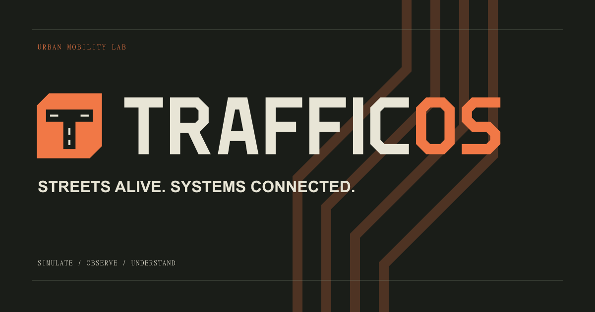
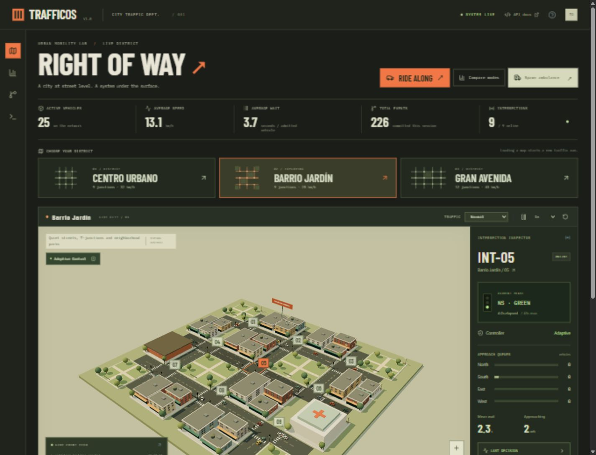
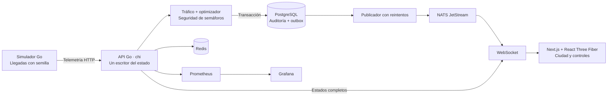

<div align="center">



# Una ciudad. Mil decisiones.

**Un laboratorio de movilidad urbana que podés explorar, intervenir y entender.**

Semáforos adaptativos, tráfico en tiempo real y ciudades 3D conectadas a un motor en Go.

[](go.mod)
[](apps/web/package.json)
[](apps/web/components/city.tsx)
[](docker-compose.yml)
[](docker-compose.yml)

[Empezar](#empezar) · [Explorar la ciudad](#explorar-la-ciudad) · [Arquitectura](#arquitectura) · [Documentación](#documentación) · [Identidad visual](#identidad-visual)

</div>

---

## La calle es de todos

¿Qué pasa si una avenida recibe más tráfico? ¿Si un bus lleva a cuarenta personas? ¿Si una ambulancia necesita cruzar la ciudad?

**TrafficOS permite observar esas situaciones y seguir las decisiones que producen.** Podés recorrer una ciudad desde arriba, subir a un vehículo, cambiar la demanda y comparar estrategias de control con las mismas condiciones iniciales.

El navegador muestra el mundo; **el servidor decide cómo funciona**. Las posiciones, las fases de los semáforos y las métricas provienen del motor de simulación. El frontend recibe estados por WebSocket e interpola el movimiento para representarlo en 3D.

## Explorar la ciudad

| En la calle | Dentro del sistema |
| --- | --- |
| **Seis mapas conectados.** Desde un barrio de 9 cruces hasta una mini ciudad de 100. | **Control adaptativo explicable.** Cada decisión conserva sus entradas, resultado y motivo. |
| **Flota mixta.** Autos, SUV, buses urbanos y ambulancias con tamaños y ocupaciones diferentes. | **Prioridad por personas.** Una política opcional considera ocupantes y espera, además de vehículos. |
| **Vista a bordo.** Observá el recorrido desde adentro o con una cámara exterior que sigue al vehículo. | **Comparaciones reproducibles.** Ciclo fijo y adaptativo reciben la misma demanda, semilla y duración. |
| **Emergencias e incidentes.** Enviá una ambulancia o creá una obra para ver cómo cambia el tráfico. | **Fallas controladas.** Desactivá el optimizador o un cruce y comprobá el ciclo local de respaldo. |

### Tu primera vuelta

1. Abrí **Elegí el mapa** y seleccioná un distrito. El cambio reinicia el tráfico y conserva la configuración del experimento.
2. Cambiá la intensidad a **Hora pico**. Observá las colas y la espera acumulada.
3. Seleccioná un cruce: **Qué pasa en el cruce** explica quién tiene paso, quién espera y cuál fue la última decisión.
4. Tocá un vehículo o **Subir a bordo**. Alterná **Desde adentro** y **Seguir vehículo**; usá **Esc** para volver.
5. Abrí **Flota y prioridad**, activá **Prioridad por personas** y seguí un bus desde su contador. También podés agregar uno con una ocupación elegida.
6. Ejecutá **Comparar modos** o **Enviar ambulancia**. Para profundizar, desplegá **Explorá el sistema**.

> La vista a bordo permite observar el viaje. El vehículo sigue siendo conducido por el motor de simulación.

### Seis formas de poner el tráfico a prueba

| Mapa | Cruces | Extensión del modelo | Carácter |
| --- | ---: | --- | --- |
| **Centro Urbano** | 9 | 160 × 160 m | Manzanas compactas y cruces cercanos. |
| **Barrio Jardín** | 9 | 176 × 168 m | Calles residenciales, árboles y menor velocidad. |
| **Gran Avenida** | 12 | 236 × 156 m | Un corredor principal y tráfico transversal. |
| **Distrito Ribera** | 25 | 328 × 304 m | Un canal y tres puentes que conectan sus márgenes. |
| **Ciudad del Parque** | 49 | 428 × 428 m | Corredores verdes y recorridos alternativos. |
| **Metrópolis** | 100 | 656 × 620 m | Torres, viviendas y sectores industriales. |

Las calles forman grafos conectados y las rutas incluyen giros. Los mapas grandes usan geometría instanciada, texturas compartidas y etiquetas cercanas a la cámara. El selector del inspector permite centrar cualquier cruce.

<details>
<summary><strong>Ver una captura del escenario 3D</strong></summary>



<p align="center"><sub>Barrio Jardín · captura de desarrollo. La interfaz actual incorpora controles en español y una nueva jerarquía visual.</sub></p>

</details>

## Empezar

### Opción A · Infraestructura completa con Docker

Necesitás **Docker Engine o Docker Desktop con Compose v2**. Esta opción no requiere Go ni Node instalados en el equipo.

```bash
git clone https://github.com/QuaDDom/trafficOS.git
cd trafficOS
docker compose up --build -d
```

Las migraciones se ejecutan automáticamente. La API espera a que sus dependencias estén disponibles.

**Abrí [TrafficOS en localhost:3000](http://localhost:3000).**

| Servicio | Dirección local |
| --- | --- |
| Ciudad y controles | [localhost:3000](http://localhost:3000) |
| Guía del proyecto | [localhost:3000/docs](http://localhost:3000/docs) |
| Logos y kit de marca | [localhost:3000/brand](http://localhost:3000/brand) |
| Swagger / OpenAPI | [localhost:8080/api/docs](http://localhost:8080/api/docs) |
| Estado de la API | [localhost:8080/health/ready](http://localhost:8080/health/ready) |
| Prometheus | [localhost:9090](http://localhost:9090) |
| Grafana | [localhost:3001](http://localhost:3001) |
| Monitor de NATS | [localhost:8222](http://localhost:8222) |

Grafana usa `admin` / `trafficos-local` en el entorno de desarrollo. Podés copiar [`.env.example`](.env.example) a `.env` para personalizar las variables. Los puertos publicados por Compose se enlazan a loopback y las credenciales incluidas son valores locales de desarrollo.

```bash
docker compose logs -f api simulator web
docker compose down
```

`down` detiene los servicios y conserva los volúmenes de datos.

### Opción B · Probar sin Docker

Necesitás **Node.js 24**, npm y **Go 1.26 o superior** en el `PATH`.

Desde la raíz del repositorio:

```bash
npm ci
node scripts/dev.mjs --memory
```

El script inicia la API, el simulador independiente y Next.js. Funciona también en Windows; no requiere Make.

**Esta opción guarda la auditoría solamente durante la sesión.** PostgreSQL, Redis y NATS aparecen como desactivados. El control del tráfico sigue ejecutándose en Go y la conexión WebSocket es real. No se cambia a memoria automáticamente cuando falla PostgreSQL.

<details>
<summary><strong>Desarrollo con dependencias en Docker y código local</strong></summary>

Instalá Node.js 24 y Go 1.26+, y copiá la configuración de ejemplo.

```powershell
# PowerShell
Copy-Item .env.example .env
```

```bash
# Bash / macOS / Linux
cp .env.example .env
```

Después:

```bash
docker compose up -d --wait postgres redis nats
npm ci
node scripts/dev.mjs
```

En sistemas con Make, `make dev` ejecuta el mismo script. Usá una sola API y un solo productor de telemetría para cada simulación.

</details>

## Arquitectura

**Un motor autoritativo, una ciudad observable.** TrafficOS combina un monolito modular en Go con un productor independiente de demanda y un frontend 3D.



| Capa | Responsabilidad |
| --- | --- |
| **Go / chi** | Comandos, validación, simulación, semáforos y API HTTP. |
| **Next.js / React / Three.js** | Interfaz, escenarios 3D, interpolación y cámaras. |
| **PostgreSQL** | Auditoría, decisiones, transiciones y outbox transaccional. |
| **Redis** | Caché del estado reciente; no decide el tráfico. |
| **NATS JetStream** | Distribución de eventos confirmados. |
| **Prometheus / Grafana** | Métricas y paneles de observabilidad. |

Los comandos se aplican sobre una copia del mundo y se publican cuando la transacción de auditoría se confirma. Los reintentos de telemetría no avanzan el reloj dos veces. El bus de eventos permite observar el sistema sin convertir el orden de sus consumidores en una condición para la seguridad de los semáforos.

<details>
<summary><strong>Recorrido por el código</strong></summary>

```text
apps/
  api/internal/
    signals/         Máquina de estados y tiempos de seguridad
    optimization/    Decisiones deterministas basadas en demanda
    simulation/      Vehículos, rutas, cruces, obras y emergencias
    application/     Comandos serializados, transacciones e idempotencia
    storage/         PostgreSQL, Redis y NATS
    realtime/        Distribución WebSocket con colas acotadas
    transport/       REST, OpenAPI, validación y registro de peticiones
    observability/   Instrumentación de Prometheus
    events/          Contrato común de eventos
  simulator/         Productor independiente de llegadas
  web/               Ciudad 3D, controles, documentación y marca
packages/
  demand/            Generador reproducible de demanda
  network/           Catálogo de mapas y grafos de calles
infrastructure/      Docker, migraciones, Prometheus y Grafana
scripts/             Desarrollo local y generación del kit de marca
docs/                Arquitectura, API, decisiones y verificaciones
```

</details>

### Cada verde tiene una explicación

- **Seguridad compartida.** Los cambios respetan un verde mínimo de 8 s, un máximo de 45 s, 3 s de amarillo y 2 s de despeje en rojo. También se aplican durante emergencias.
- **Control adaptativo.** Evalúa colas, espera en la aproximación actual y llegadas próximas. Las decisiones incluyen sus entradas y el motivo del resultado. El ciclo fijo y el respaldo usan verdes de 25 s.
- **Personas antes que vehículos, si lo elegís.** La política opcional pondera ocupación y espera. Un bus lleno puede representar más demanda que varios autos. Las emergencias conservan precedencia.
- **Comparaciones honestas.** Ambos controladores reciben la misma demanda. La espera media incluye la acumulada por vehículos que todavía no llegaron; las llegadas rechazadas también se registran. No hay un ganador predeterminado.

La prioridad por personas es una regla demostrativa inspirada en [Transit Signal Priority](https://www.transit.dot.gov/research-innovation/signal-priority) y en [OCC-MP](https://arxiv.org/abs/2406.19269). No reproduce el algoritmo completo del artículo ni representa una política calibrada para una ciudad real.

## Documentación

| Quiero entender… | Abrir |
| --- | --- |
| Los controles y el funcionamiento general | [Guía dentro de la aplicación](http://localhost:3000/docs) · [Código de la guía](apps/web/app/docs/page.tsx) |
| Los componentes y el flujo de datos | [Arquitectura](docs/architecture.md) |
| Los endpoints y los mensajes en vivo | [API](docs/api.md) · [Swagger local](http://localhost:8080/api/docs) |
| Los contratos de eventos | [Eventos](docs/events.md) |
| Las decisiones de ingeniería | [Decisiones técnicas](docs/decisions.md) · [ADRs](docs/adr/) |
| Qué se probó y qué se midió | [Verificaciones](docs/verification.md) · [Benchmarks](docs/benchmarks.md) |

La guía de `/docs` es estática y puede leerse aunque la API esté desconectada. Los enlaces a `localhost` requieren iniciar el proyecto.

## Pruebas y calidad

```bash
go test ./...
go test -race ./...
go vet ./...
npm test
npm run build
```

La suite cubre tiempos de seguridad, rutas y conservación de la flota, prioridad por ocupación, emergencias, comparación reproducible, reintentos, rollback y comunicación WebSocket. En Windows, el detector de carreras de Go requiere CGO y un compilador C compatible.

Para probar las integraciones reales:

```bash
docker compose up -d --wait postgres redis nats
go test -tags=integration -v ./apps/api/internal/storage ./apps/api/internal/transport
```

Estas pruebas requieren sus dependencias y escriben registros en una base de desarrollo. No las sustituyen por mocks ni las omiten cuando faltan servicios.

El [workflow de GitHub Actions](.github/workflows/ci.yml) está configurado para ejecutar pruebas, análisis estático, build e integración en cada push o pull request. Los resultados locales documentados están en el [registro de verificación](docs/verification.md).

## Identidad visual

**Asfalto, papel claro y naranja de señalización.** TrafficOS toma su lenguaje de las calles: letras compactas, marcas viales y decisiones que se pueden leer.

<p align="center">
  <picture>
    <source media="(prefers-color-scheme: dark)" srcset="apps/web/public/brand/logo-light.svg" />
    <source media="(prefers-color-scheme: light)" srcset="apps/web/public/brand/logo-dark.svg" />
    
  </picture>
</p>

| Asfalto | Señal | Papel | Salvia | Concreto |
| --- | --- | --- | --- | --- |
| `#1A1D18` | `#F17846` | `#E8E5D6` | `#B8C69A` | `#858B79` |

El símbolo es una intersección en T dentro de una señal; el lettering usa trazados propios. Los logos SVG no dependen de fuentes instaladas. El kit incluye PNG transparentes, variantes monocromas, iconos y portada social.

**[Logo SVG](apps/web/public/brand/logo-dark.svg) · [Logo PNG](apps/web/public/brand/logo-dark.png) · [Kit completo ZIP](apps/web/public/brand/trafficos-brand-kit.zip) · [Guía de marca](apps/web/public/brand/README.md)**

```bash
npm run brand:build
```

Este comando regenera los archivos desde [`scripts/build-brand.mjs`](scripts/build-brand.mjs). La aplicación usa los mismos recursos que se distribuyen en el kit.

## Alcance y próximos pasos

TrafficOS es un proyecto de simulación y arquitectura de software. Los mapas, la demanda y las ocupaciones son sintéticos.

- Hasta **600 vehículos activos**; las llegadas que no pueden admitirse se contabilizan.
- Rutas con giros y reservas de cruce. Todavía no hay cambios de carril, peatones, rotondas ni un solucionador físico completo de colisiones.
- Los buses tienen ocupación simulada, pero no horarios, paradas ni subida y bajada de pasajeros.
- Una sola API escribe cada mundo. Reiniciarla crea una nueva simulación; en modo PostgreSQL se conserva la auditoría, no el estado vivo completo para reanudar el viaje.
- La reconexión recupera el estado actual; no garantiza recuperar todos los eventos perdidos en el navegador.
- La demo local no incorpora autenticación de usuarios. Publicarla requiere definir controles de acceso y configuración de despliegue.

Las siguientes líneas de evolución son paradas de buses, fases peatonales, carriles de giro, mapas geográficos, demanda calibrada e integración con SUMO. El [registro técnico](docs/decisions.md) explica las decisiones y los límites actuales.

---

<p align="center">
  <br/>
  <strong>TRAFFICOS</strong><br/>
  <sub>La calle es de todos. Cada decisión cuenta.</sub>
</p>
